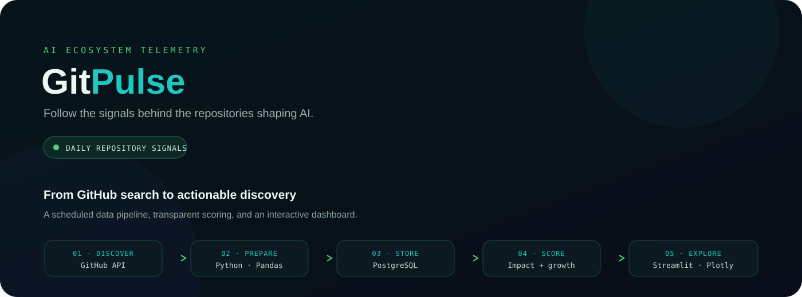
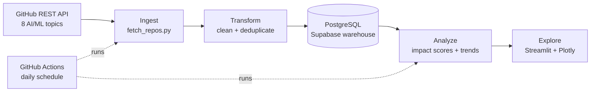

<div align="center">
  
  <br />
  <a href="https://gitpulse-64rqmapppv4wwlu8qpghuam.streamlit.app/"><strong>↗ Open the live dashboard</strong></a>
  &nbsp;·&nbsp;
  <a href="#run-locally"><strong>Run it locally</strong></a>
</div>

<div align="center">

[](https://www.python.org/)
[](https://streamlit.io/)
[](https://www.postgresql.org/)
[](https://github.com/varunNeon/GitPulse/actions)

</div>

> **GitPulse** tracks AI and machine learning repositories, scores their signals, and helps surface the projects gaining momentum.

<div align="center">

[Overview](#what-you-can-explore) · [How it works](#how-it-works) · [Scoring](#impact-score) · [Setup](#run-locally) · [Project layout](#project-structure)

</div>

## What you can explore

GitPulse collects repositories across eight AI and ML topics, stores daily snapshots, and turns them into an interactive dashboard. Use the live app to explore the latest tracked data; the repository list and snapshot history grow as the scheduled pipeline runs.

| Dashboard view | What it shows | Interaction |
|---|---|---|
| **Overview** | Snapshot health, standout repositories, hidden gems, and language/topic charts | Hover charts for details |
| **Leaderboard** | Repositories ranked by impact score and its component signals | Filter by language and topics; inspect sortable data |
| **Trends** | Historical star growth and repository comparisons | Select repositories and hover the time series |
| **Anomalies** | Latest growth outliers against a statistical threshold | Compare flagged growth with the threshold |

<details>
<summary><strong>How the live dashboard is refreshed</strong></summary>

The GitHub Actions pipeline runs daily at **06:00 IST**. It fetches repositories, transforms and deduplicates the results, loads the warehouse, and calculates impact scores. A separate keep-alive workflow checks hourly, while its saved state limits actual wake-ups to once every 10 hours.

</details>

## How it works




The pipeline is orchestrated by `pipeline/runner.py`. It creates the schema, fetches and transforms repository data, then upserts repository details and daily statistics. The scoring step runs after the pipeline in the daily GitHub Actions workflow.

## Impact score

Each tracked repository receives a score from **0 to 1**. The components are min-max normalized for the current snapshot before the weighted sum is calculated:

<div align="center">

**Impact = 0.50 × Star velocity + 0.30 × Fork score + 0.20 × Issue score**

</div>

- **Star velocity**: normalized repository star count in the current snapshot.
- **Fork score**: normalized fork-to-star ratio, a signal of reuse and derivative work.
- **Issue score**: normalized open issue count, used as a rough activity signal.

A high score is a ranking signal across this tracked set, not a universal measure of software quality. A hidden gem is selected separately: it has below-median stars and an above-average fork-to-star ratio.

<details>
<summary><strong>How to read the score</strong></summary>

The components are normalized against the repositories in the same snapshot, so scores are relative and can change as the tracked set changes. The issue component is only a proxy; open issue counts alone do not establish project health or adoption.

</details>

## Data model

| Table | Grain | Purpose |
|---|---|---|
| `dim_repos` | One row per repository | Names, language, topics, URL, and repository timestamps |
| `dim_users` | One row per GitHub user | User profile attributes |
| `fact_repo_stats` | One row per repository per snapshot date | Stars, forks, watchers, and open issues |
| `fact_repo_scores` | One row per repository per snapshot date | Composite score and normalized components |

Daily fact tables use a repository and snapshot date pair to keep snapshots unique. Historical rows power the trend charts.

## Tech stack

| Layer | Tools |
|---|---|
| Source | GitHub REST API |
| Ingestion | Python, Requests |
| Transform | Pandas |
| Warehouse | PostgreSQL, Supabase, SQLAlchemy |
| Analysis | Pandas, NumPy |
| Dashboard | Streamlit, Plotly |
| Automation | GitHub Actions |

**Topics tracked:** `machine-learning` · `deep-learning` · `llm` · `computer-vision` · `data-engineering` · `mlops` · `pytorch` · `transformers`

## Run locally

Requires **Python 3.11** and a PostgreSQL database.

```bash
git clone https://github.com/varunNeon/GitPulse.git
cd GitPulse
python -m venv .venv
# macOS / Linux
source .venv/bin/activate
# Windows PowerShell: .venv\Scripts\Activate.ps1
pip install -r requirements.txt
```

Create a `.env` file in the project root. Keep credentials out of commits; GitPulse reads the database settings and optional GitHub token from the environment.

```dotenv
GITHUB_TOKEN=your_github_pat
DB_HOST=your_db_host
DB_PORT=5432
DB_NAME=gitpulse
DB_USER=postgres
DB_PASSWORD=your_password
```

Initialize the schema, run the daily ingestion, then calculate scores:

```bash
python -m warehouse.schema
python -m pipeline.runner
python -m analysis.impact_score
streamlit run dashboard/app.py
```

Open the local Streamlit URL printed in the terminal. The dashboard needs a populated database to show repository data. A GitHub token is optional for local fetches, but authenticated requests get a higher API rate limit.

<details>
<summary><strong>Run the automated checks</strong></summary>

The daily workflow compiles the Python source and runs the test suite before it contacts GitHub or the database:

```bash
python -m compileall .
pytest
```

</details>

## Project structure

```text
GitPulse/
├── analysis/
│   ├── impact_score.py      # Impact scores and hidden gems
│   └── trends.py            # Growth and anomaly analysis
├── common/                  # Runtime configuration and logging
├── dashboard/
│   └── app.py               # Streamlit dashboard
├── docs/assets/
│   └── gitpulse-architecture.svg
├── ingestion/
│   └── fetch_repos.py       # GitHub API fetcher
├── pipeline/
│   ├── runner.py            # End-to-end ETL orchestration
│   ├── transform.py         # Cleaning and deduplication
│   └── load.py              # Warehouse upserts
├── warehouse/
│   ├── db.py                # Database connection
│   └── schema.py            # PostgreSQL table definitions
├── scripts/
│   └── keep_streamlit_alive.py
└── .github/workflows/
    ├── pipeline.yml         # Daily ingestion + scoring
    └── keep_alive.yml       # Streamlit keep-alive check
```

## Built by

**Varun Lal** · MSc Data Science and Analytics, Jain University

[GitHub](https://github.com/varunNeon) · [LinkedIn](https://www.linkedin.com/in/varunnlal/)

---

<div align="center">
  <a href="https://gitpulse-64rqmapppv4wwlu8qpghuam.streamlit.app/"><strong>Explore GitPulse ↗</strong></a>
  <br /><br />
  <sub>Built to make the fast-moving AI ecosystem a little easier to follow.</sub>
</div>
